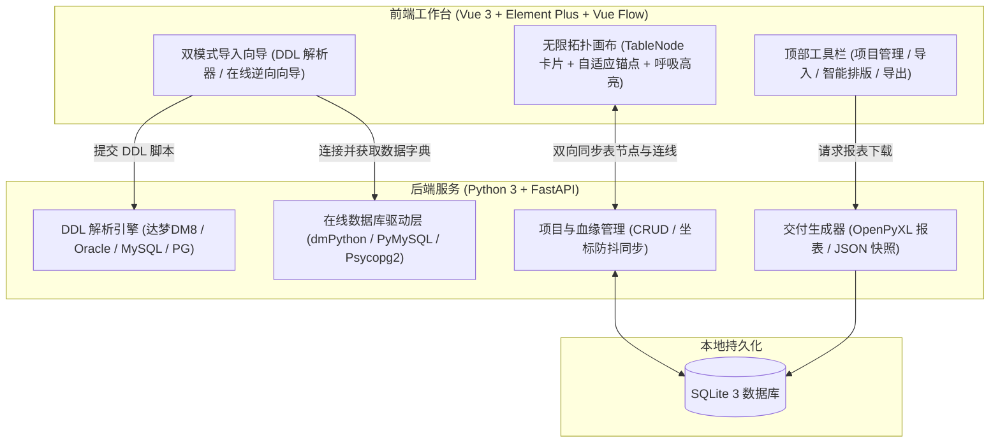

# ColLink (Column Linker)

<p align="center">
  <strong>新一代轻量级、可视化字段血缘与映射设计平台</strong><br>
  <em>Next-Generation Visual Field-Level Lineage & Mapping Studio</em>
</p>

<p align="center">
  
  
  
  
  
</p>

---

## 📖 项目简介

在企业级数据治理、系统割接割接、数据中台构建以及数仓 ETL 建模（ODS ➔ DWD ➔ DWS）过程中，开发人员长期面临**“字段去向口径不透明、文档零散易过期、表结构变动难追踪”**的痛点。

**ColLink** 专为数据架构师、数仓工程师和建模师打造。无需安装笨重平台或配置复杂服务，通过**直观的无限拓扑画布**与**字段级交互连线**，轻松完成表与表之间字段血缘关系的梳理、可视化呈现与规范化成果交付。

---

## ✨ 核心特性亮点

### 1. 🎯 字段级 1 对 1 / 1 对多精准拓扑连线
- **显式拖拽锚点（Port Handle）**：每个字段右侧配备高亮蓝圈交互锚点，悬停时光标变为精准十字线（`crosshair`），按住拖动即可向外拉出平滑平移曲线；
- **智能最短路径自适应算法（Shortest Path Algorithm）**：系统实时根据两表的相对坐标动态计算，源表在左则连至目标表左侧，源表在右则连至目标表右侧，**彻底根除连线绕行卡片外围的问题**；
- **灵活映射基数**：原生支持一对一映射、一对多广播映射以及多对一收敛映射。

### 2. 💡 按需显隐与字段呼吸发光联动
- **默认清爽无干扰**：默认隐藏所有复杂连线，告别几十张表同时连线时的“蜘蛛网”视觉杂乱；
- **点击激活与呼吸光效**：单击任意带有血缘关系的字段，两端关联字段立即激活柔和的**呼吸脉冲发光（Breathing Pulse）**动效；
- **自动滚动定位对齐（Auto-Scroll into View）**：激活映射时，目标表即使拥有数十个字段的长列表，也会**自动平滑滚动**至对应关联字段的可视区域；
- **一键取消**：点击空白背景或无关联字段，画布瞬间复原隐藏。

### 3. 🖱️ 表卡片滚轮交互隔离（Zero Zoom Interference）
- 彻底解决画布滚轮劫持问题。鼠标停留在卡片字段列表上滚动时，**精准滚动卡片内部列表**；只有在空白画布处滚动滚轮才会执行画布缩放（Zoom In/Out）。

### 4. 🔄 双模式表结构采集引擎
- **DDL 脚本极速解析导入**：
  - **优先深度兼容达梦数据库（DM8/DM7）**：全面解析达梦特有类型（`VARCHAR2`, `NUMBER`, `DATETIME`, `CLOB` 等）及独立的 `COMMENT ON TABLE` / `COMMENT ON COLUMN` 语法；
  - 兼顾 MySQL 行内注释语法与 PostgreSQL 注释语法；
  - 支持粘贴 SQL 文本或上传 `.sql` 文件。
- **在线数据库逆向拉取向导**：
  - 支持达梦（DM）、MySQL、PostgreSQL 数据字典直接查询；
  - **项目级智能记住配置**：各项目独立记忆数据库连接配置，再次点击直接直达选表步骤，无需重复输入密码与测试；
  - **画布双向勾选同步**：已在画布中的表自动打上 `[已在画布]` 标签并预先勾选；
  - **取消勾选二次确认删除**：取消勾选已在画布的表时触发安全警示弹窗，确认后同步级联删除画布表与关联血缘。

### 5. 📊 规范化交付物多格式导出
- **Excel 规范映射清单（.xlsx）**：一键导出双工作表报表（*Sheet1: 字段血缘映射清单*，*Sheet2: 数据表结构字典*），内置高雅商务配色与单元格自适应排版；
- **高清架构图导出**：支持 2x 超清将当前画布完整导出为 PNG 架构拓扑图；
- **项目快照备份与迁移**：全量导出 `.json` 备份包，支持换机一键导入还原全部表节点与映射。

---

## 🏗️ 系统架构



---

## 🚀 快速启动指南

### 方式一：一键双击启动（Windows 推荐）

直接双击运行根目录下的 **`run_dev.bat`**，或在 PowerShell 中执行：

```powershell
.\run_dev.ps1
```

启动完成后，系统将自动弹出两个终端服务：
- 🌐 **前端交互界面**：[http://localhost:5173](http://localhost:5173)
- 📚 **后端 API 文档 (Swagger)**：[http://127.0.0.1:8000/docs](http://127.0.0.1:8000/docs)

---

### 方式二：手动分步启动

#### 1. 后端服务启动
```powershell
cd backend
# 激活虚拟环境并启动
.\.venv\Scripts\python.exe -m uvicorn app.main:app --host 127.0.0.1 --port 8000 --reload
```

#### 2. 前端服务启动
```powershell
cd frontend
npm run dev
```

---

## 📂 项目工程结构

```
ColLink/
├── backend/                     # 后端工程 (FastAPI + SQLAlchemy)
│   ├── app/
│   │   ├── api/routes/          # 路由模块 (projects, tables, mappings, ddl, connections, export)
│   │   ├── core/                # SQLite 数据库引擎与 Session 管理
│   │   ├── models/              # ORM 实体 (Project, TableMeta, ColumnMeta, FieldMapping)
│   │   ├── schemas/             # Pydantic 校验与传输对象
│   │   ├── services/
│   │   │   ├── ddl_parser.py    # 达梦/MySQL/PG DDL 与注释智能分词器
│   │   │   ├── db_connector.py  # 在线数据库元数据逆向适配器
│   │   │   └── exporter.py      # Excel 规范报表与 JSON 快照生成器
│   │   └── main.py              # FastAPI 应用入口
│   ├── data_field_mapper.db     # 本地单文件 SQLite 数据库
│   └── requirements.txt         # Python 依赖清单
├── frontend/                    # 前端工程 (Vue 3 + Vite + TypeScript)
│   ├── src/
│   │   ├── api/                 # Axios 请求接口定义
│   │   ├── components/
│   │   │   ├── canvas/          # Vue Flow 自定义 TableNode、Toolbar、MappingDrawer
│   │   │   └── dialogs/         # DDL 导入、在线连接向导、项目管理、快照迁移弹窗
│   │   ├── stores/              # Pinia 状态树 (projectStore, canvasStore)
│   │   ├── views/               # 工作台主视图 (WorkspaceView.vue)
│   │   └── types/               # TypeScript 类型定义
│   ├── package.json
│   └── vite.config.ts
├── run_dev.bat                  # Windows 批处理一键启动脚本
├── run_dev.ps1                  # PowerShell 一键启动脚本
├── .gitignore                   # Git 忽略配置
└── README.md                    # 项目说明文档
```

---

## 📄 开源许可证

本项目基于 [MIT License](LICENSE) 开源。欢迎提 Issue 与 PR 共建完善！
