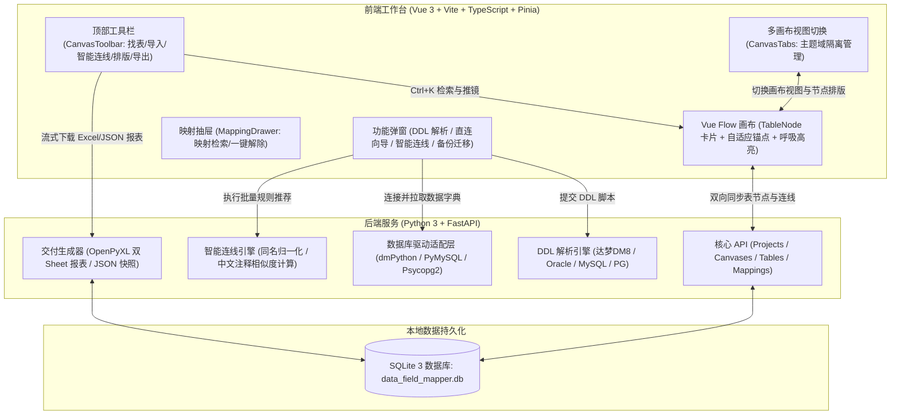

# ColLink (Column Linker)

<p align="center">
  <strong>新一代轻量级、可视化字段级血缘与映射设计平台</strong><br>
  <em>Next-Generation Visual Field-Level Lineage & Mapping Studio</em>
</p>

<p align="center">
  
  
  
  
  
  
  
</p>

---

## 📖 项目背景与痛点

在企业级数据治理、系统割接重构、数据中台搭建以及数仓 ETL 建模（ODS ➔ DWD ➔ DWS ➔ ADS）过程中，数据开发与架构人员常常面临以下痛点：
- **血缘口径不透明**：字段加工来源与去向散落在大量的 SQL、ETL 脚本或零散的 Excel 中，交接难、维护成本高；
- **可视化工具繁重**：开源或商业大数据治理平台（如 DataHub、Atlas 等）架构庞大，依赖 Hadoop/Kafka/ElasticSearch，普通项目难以轻量部署；
- **传统绘图软件交互弱**：Visio、Draw.io、Figma 等工具无法感知数据表字段结构，连线繁琐、卡片移动后容易线缆缠绕，且无法自动生成标准化数据字典。

**ColLink (Column Linker)** 专为数仓工程师、数据架构师和建模师量身打造。**零外部复杂依赖、开箱即用**。通过直观的无限拓扑画布、字段级精准交互连线、智能同名同义自动匹配、同项目多主题域视图及一键交付物导出，让数据血缘梳理变得高效、清爽且规范。

---

## ✨ 核心特性亮点

### 1. 🎯 字段级精准拓扑与自适应最短路径
- **显式拖拽锚点（Port Handle）**：每个字段配备高亮蓝圈交互锚点，悬停时光标变为精准十字准星（`crosshair`），拖拽即可拉出平滑平移曲线；
- **智能最短路径自适应算法**：系统根据节点间相对几何位置动态选择最佳连接侧（左侧入/右侧出或同侧绕行避让），**彻底解决跨表连线横穿卡片外围或重叠的问题**；
- **灵活映射基数**：原生支持一对一直接映射、一对多广播映射以及多对一聚合收敛映射。

### 2. 💡 按需显隐与字段呼吸发光联动
- **默认清爽无干扰**：非激活状态下隐藏所有连线，告别数十张表同时呈现时的“蜘蛛网”视觉疲劳；
- **点击激活与双向呼吸光效**：单击任意已连线字段，两端关联字段与连线立即激活柔和的**呼吸脉冲发光（Breathing Pulse）**动效；
- **自动滚动定位对齐（Auto-Scroll into View）**：激活映射时，若关联字段位于长列表可视范围外，目标表卡片将**自动平滑滚动**至对应字段行；
- **一键复原**：点击空白画布或无映射字段即可重置视觉焦点。

### 3. 🔍 画布全局快速找表/找字段与平滑推镜 (`Ctrl + K`)
- **秒级模糊全局检索**：支持搜索表英文名（`table_name`）、中文表注释（`table_comment`）以及表内具体字段名与字段注释；
- **平滑推镜聚焦（Vue Flow FitView）**：在搜索下拉项中选中后，画布视角平滑推镜缩放聚焦至目标卡片中心，并附加 2.5 秒**脉冲高亮光环**，帮助瞬间在庞大画布中定位核心资产。

### 4. 📑 同项目多画布（业务主题域视图 Tabs）
- **主题域视角切分**：同一个项目支持创建多个独立的画布视图（如“客户域-ODS到DWD”、“交易链路分析”、“财务核算主题”）；
- **节点轻量归属管理**：表节点与坐标在不同画布视图间按需展示或独立排版，彻底解决一张大画布承载几百张表时的卡顿与杂乱问题；
- **视图 Tab 操作**：支持视图新增、快速重命名、双击编辑、便捷删除与状态持久化。

### 5. 🪄 智能同名 / 同义字段自动连线 (Auto-Mapping)
- **极速一键匹配**：针对几十甚至上百个字段的大宽表，无需逐一连线；
- **多策略智能匹配**：
  - **同名字段精确匹配**：自动忽略大小写差异与下划线风格（如 `WORK_PLAN_ID`、`work_plan_id`、`workplanid` 自动识别为同一字段）；
  - **中文注释同义匹配**：双方英文名不同但业务注释一致时（如“创建时间”与“录入时间”、“部门编码”与“所属机构代码”），智能识别关联并批量生成血缘连线；
- **预览与冲突检测**：弹窗内清晰预览即将建立的连线清单，支持自主勾选确认，杜绝误操作。

### 6. 🃏 现代 SaaS 级表卡片交互与字段过滤
- **现代清爽 UI 设计**：全面去 Emoji 化，采用 `@element-plus/icons-vue` 线性矢量图标与清爽品牌蓝视觉体系；
- **卡片内字段实时过滤**：卡片头部内置快速过滤框，输入关键字实时筛选当前表的字段；
- **「仅看已映射字段」折叠开关**：一键隐藏未连线冗余字段，使卡片高度收缩至仅显示核心血缘字段，视野清晰度倍增；
- **主键徽章与类型标签**：内置 `PK` 钥匙徽章高亮及字段物理类型（`VARCHAR2`, `BIGINT`, `TIMESTAMP` 等）精致胶囊展示。

### 7. 🔄 双模式表结构采集引擎
- **DDL 脚本智能极速解析**：
  - **深度兼容国产达梦数据库（DM8/DM7）**：全面解析达梦特有数据类型及独立的 `COMMENT ON TABLE` / `COMMENT ON COLUMN` 语法；
  - **兼容主流数据库**：支持 MySQL 行内注释语法、PostgreSQL 语法及 Oracle 模式；
  - 支持直接粘贴 SQL 文本或拖拽上传 `.sql` 文件。
- **数据库直连逆向拉取向导**：
  - 支持达梦（DM）、MySQL、PostgreSQL 数据库直连；
  - **项目级连接配置记忆**：各项目独立保存连接参数与密码（本地加密），再次打开直接进入选表界面，无需重复输入。

### 8. 📊 规范化交付物多格式流式导出
- **规范化 Excel 映射清单（.xlsx）**：
  - 生成双工作表报表：*Sheet1: 字段血缘映射清单*，*Sheet2: 数据表结构字典*；
  - 采用优雅商务配色与自适应列宽排版，支持直接作为项目交付物或开发规范；
- **2x 超清架构图导出**：一键将当前画布完整导出为 2x 视网膜高清 PNG 拓扑图；
- **项目快照备份与跨机迁移**：全量导出 `.json` 备份包，支持团队分享或换机一键还原项目全部表节点与映射；
- **流式 Blob 安全下载**：前端采用 Axios 二进制流式 Blob 下载技术，彻底解决端口变动或 WebView 环境下提示“127.0.0.1 拒绝连接”的问题。

### 9. ⌨️ 全局快捷键与防冲突撤销/重做
- 支持画布历史记录撤销与重做；
- **智能焦点保护**：当在搜索框、文本域内输入文字时，自动避让，不拦截原生文本撤销。

---

## ⌨️ 快捷键总览 (Shortcuts)

| 快捷键 | 功能操作 | 说明与适用场景 |
| :--- | :--- | :--- |
| **`Ctrl + K`** | 快速找表 / 找字段 | 唤起全局检索框，输入表名、注释或字段名即刻定位并推镜聚焦 |
| **`Ctrl + Z`** | 撤销 (Undo) | 撤销上一步连线或节点操作（输入框打字时不拦截） |
| **`Ctrl + Y`** / **`Ctrl + Shift + Z`** | 重做 (Redo) | 重做上一步撤销的操作 |
| **`Space` + 鼠标左键拖拽** | 平移画布 | 无需触碰滚动条，任意平移漫游 |
| **鼠标滚轮** | 画布缩放 | 放大缩小画布视野（支持 0.1x ~ 2.0x） |
| **鼠标单击字段** | 聚焦血缘连线 | 激活目标字段血缘脉冲连线，同时使远端对应字段自动滚入视野 |
| **点击空白区域** | 取消聚焦连线 | 恢复默认清爽无连线状态 |

---

## 🏗️ 系统架构设计



---

## 🚀 快速启动指南

### 方式一：🖥️ 原生桌面客户端启动（日常使用推荐，极简零繁琐）

直接双击项目根目录下的 **`ColLink.bat`** 即可：

- ✨ **一键即开**：基于 Windows 原生 Edge WebView2 驱动，无需手动打开浏览器，无需分别运行多个黑窗口命令行；
- 🔇 **无黑窗口打扰**：采用静默模式在后台加载，界面启动后提供纯正的原生桌面客户端体验；
- 🔌 **智能动态避让端口**：自动探测空闲本地端口，防止默认端口冲突；
- 🛠️ **调试与日志查看**：若导入异常或需查看 SQL 解析日志，可双击 **`ColLink_Debug.bat`** 启动带控制台版本。

---

### 方式二：💻 开发者双端热更联调模式

若需要对前端或后端代码进行二次开发与实时热更新调试，双击运行根目录下的 **`run_dev.bat`**，或在 PowerShell 中执行：

```powershell
.\run_dev.ps1
```

启动完成后，系统将自动弹出两个终端服务并开启热更：
- 🌐 **前端交互界面 (Vite)**：[http://localhost:5173](http://localhost:5173)
- 📚 **后端 API 文档 (Swagger UI)**：[http://127.0.0.1:8000/docs](http://127.0.0.1:8000/docs)

---

### 方式三：手动分步启动

#### 1. 后端服务启动
```powershell
cd backend
# 激活 Python 虚拟环境并运行 uvicorn
.\.venv\Scripts\python.exe -m uvicorn app.main:app --host 127.0.0.1 --port 8000 --reload
```

#### 2. 前端服务启动
```powershell
cd frontend
npm install   # 首次安装依赖
npm run dev   # 启动开发服务器
```

#### 3. 前端生产打包编译
```powershell
cd frontend
npm run build # 编译产物自动输出至 frontend/dist
```

---

## 📂 项目工程目录说明

```
ColLink/
├── backend/                     # 后端工程 (FastAPI + SQLAlchemy)
│   ├── app/
│   │   ├── api/routes/          # RESTful 接口路由
│   │   │   ├── canvases.py      # 多画布视图管理接口 (CRUD、视图表放置)
│   │   │   ├── connections.py   # 在线数据库连接测试与元数据拉取
│   │   │   ├── ddl.py           # DDL 脚本解析接口
│   │   │   ├── export.py        # Excel 报表与 JSON 快照导出
│   │   │   ├── mappings.py      # 字段映射管理与智能自动连线匹配
│   │   │   ├── projects.py      # 项目创建、重命名与切换
│   │   │   └── tables.py        # 表结构与列元数据管理
│   │   ├── core/                # SQLite 数据库配置与会话生命周期
│   │   ├── models/              # ORM 实体模型 (Project, CanvasView, TableMeta, ColumnMeta, FieldMapping)
│   │   ├── schemas/             # Pydantic 校验与数据交换契约
│   │   ├── services/
│   │   │   ├── ddl_parser.py    # 达梦/MySQL/PG/Oracle DDL 分词解析器
│   │   │   ├── db_connector.py  # 达梦 DM8/MySQL/PostgreSQL 驱动适配器
│   │   │   └── exporter.py      # OpenPyXL 双工作表美化排版生成器
│   │   └── main.py              # FastAPI 应用入口与中间件配置
│   ├── data_field_mapper.db     # 本地单文件 SQLite 数据库 (自动初始化)
│   └── requirements.txt         # Python 依赖清单
├── frontend/                    # 前端工程 (Vue 3 + Vite + TypeScript)
│   ├── src/
│   │   ├── api/                 # Axios 统一接口封装
│   │   ├── components/
│   │   │   ├── canvas/          # 画布核心组件
│   │   │   │   ├── AutoMappingDialog.vue  # 智能同名/同义连线弹窗
│   │   │   │   ├── CanvasTabs.vue         # 业务主题域画布视图 Tab 栏
│   │   │   │   ├── CanvasToolbar.vue      # 顶部综合操作与检索工具栏
│   │   │   │   ├── MappingDrawer.vue      # 映射清单审查与管理侧边抽屉
│   │   │   │   └── TableNode.vue          # 自定义数据表节点卡片 (含过滤/折叠/呼吸灯)
│   │   │   └── dialogs/         # 业务向导弹窗
│   │   │       ├── BackupDialog.vue       # JSON 快照备份与导入弹窗
│   │   │       ├── DbConnectDialog.vue    # 连接数据库导入向导
│   │   │       ├── DdlImportDialog.vue    # DDL 文本与文件解析导入向导
│   │   │       └── ProjectDialog.vue      # 项目管理与新建弹窗
│   │   ├── stores/              # Pinia 状态管理 (projectStore, canvasStore)
│   │   ├── utils/
│   │   │   └── download.ts      # 二进制 Blob 流式安全下载工具
│   │   ├── views/
│   │   │   └── WorkspaceView.vue# 工作台主视图 (集成 Vue Flow 画布与事件监听)
│   │   └── types/               # TypeScript 类型定义
│   ├── package.json
│   └── vite.config.ts
├── ColLink.bat                  # Windows 极简静默一键启动桌面客户端
├── ColLink_Debug.bat            # Windows 调试模式启动 (带实时后端控制台日志)
├── desktop.py                   # PyWebView 桌面宿主启动脚本 (动态避让端口)
├── run_dev.bat                  # Windows 批处理一键热更联调启动
├── run_dev.ps1                  # PowerShell 一键热更联调启动
├── .gitignore                   # Git 忽略配置
└── README.md                    # 项目说明文档
```

---

## 💡 常见问题与使用贴士 (FAQ)

### Q1: 导出 Excel 或下载备份时出现“127.0.0.1 拒绝连接”？
> **A**: 该问题在最新版本中已彻底修复。前端已升级为基于 Axios 的二进制 Blob 流式下载（`downloadFileStream`），所有请求均走应用统一配置的相对路径与代理，即使系统动态分配了随机端口或在 WebView 环境下也能顺畅下载。

### Q2: 达梦数据库（DM8）连接导入失败？
> **A**: 
> 1. 请确保 Python 环境中已安装达梦官方驱动包 `dmPython`；
> 2. 检查操作系统是否已正确配置达梦客户端运行库环境变量（即达梦安装目录下的 `bin` 路径，包含 `dmdpic.dll` / `libdmdpic.so`）；
> 3. 若无达梦直接连接环境，可直接导出达梦的 `.sql` 建表语句，使用 **「DDL 解析导入」** 功能，解析引擎原生深度支持达梦语法。

### Q3: 键盘按 `Ctrl+Z` 撤销时，会不会影响我在输入框里正在打的字？
> **A**: 不会。快捷键监听器内置了活动元素判断，当焦点在 `<input>`、`<textarea>` 或可编辑区域时，会自动交由浏览器处理原生打字撤销；只有在操作画布卡片时才会触发画布历史步进回滚。

### Q4: 如何在不同业务域之间快速切换展示？
> **A**: 在顶部工具栏下方的「多画布视图 Tab」中点击 `+` 即可创建新的主题域视图（如 `销售数据域`、`供应链域`），并在新画布中独立拖入表结构进行连线排版，各个画布视图互不影响。

---

## 📄 开源许可证

本项目基于 [MIT License](LICENSE) 开源发布。欢迎数据从业者共同体验与提出宝贵建议！
