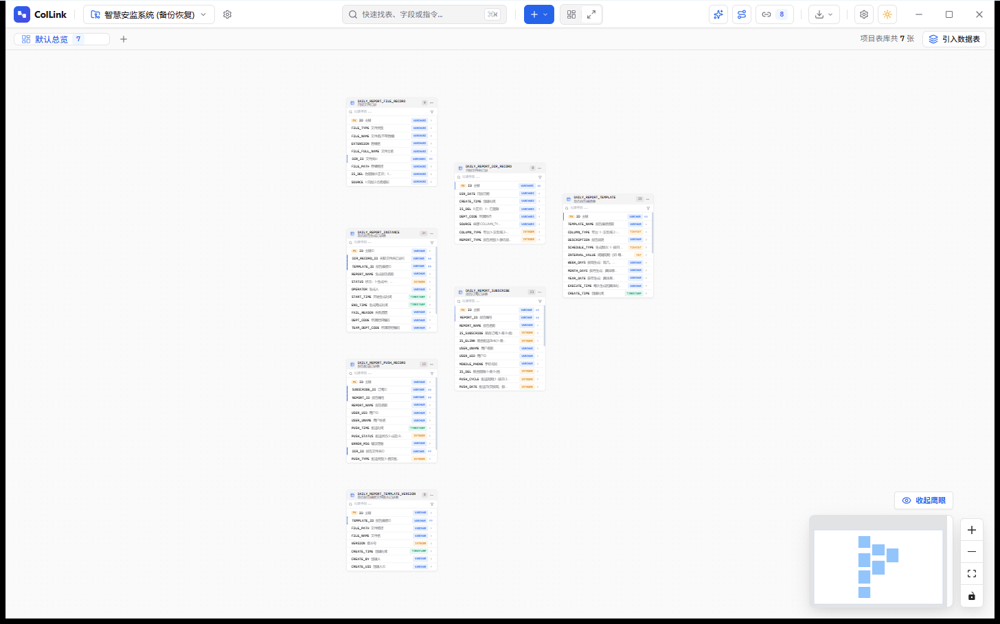
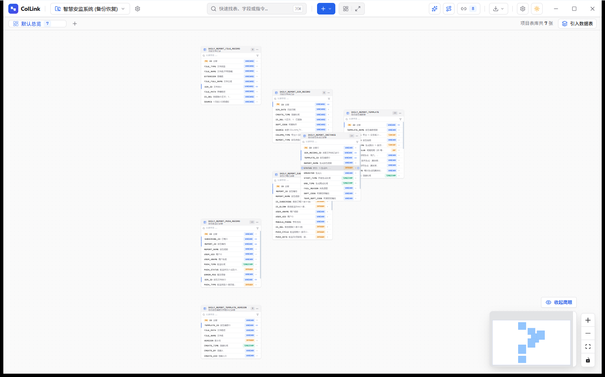
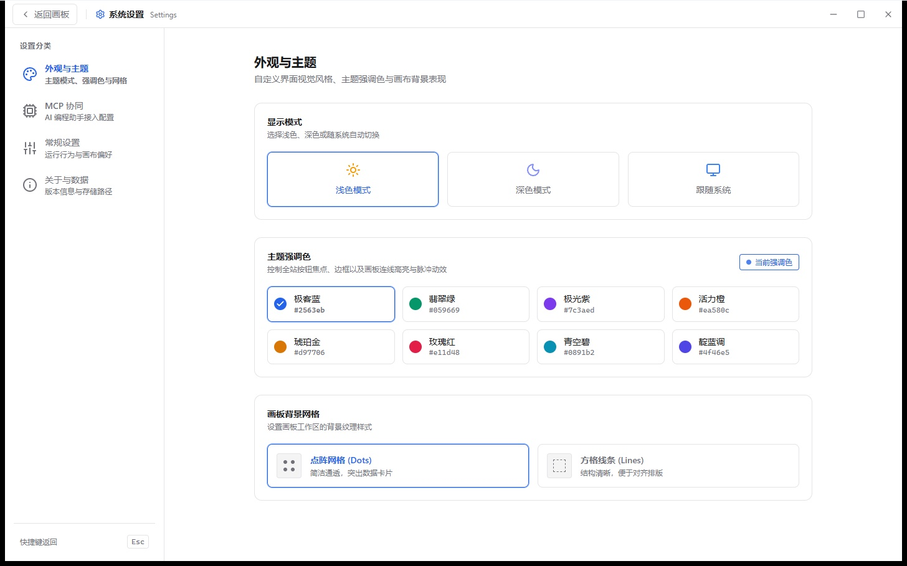
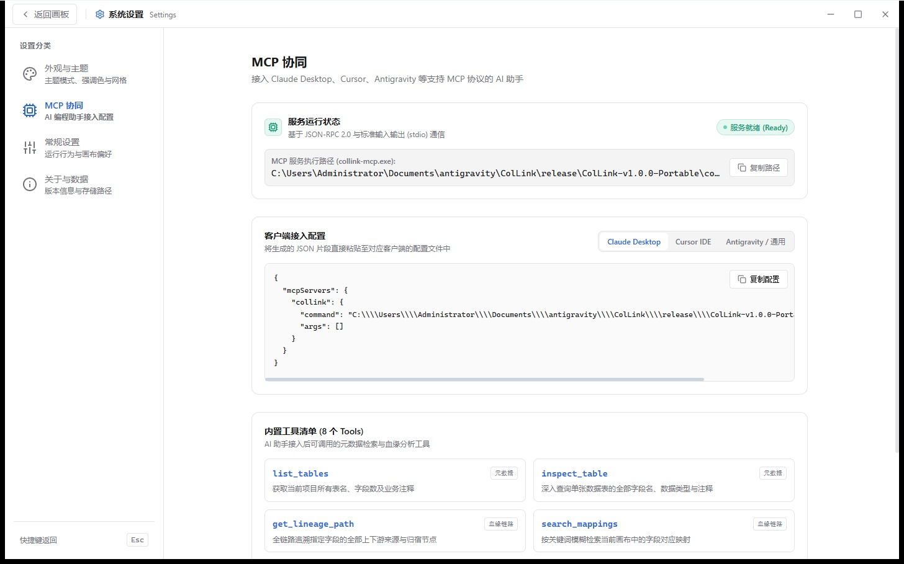
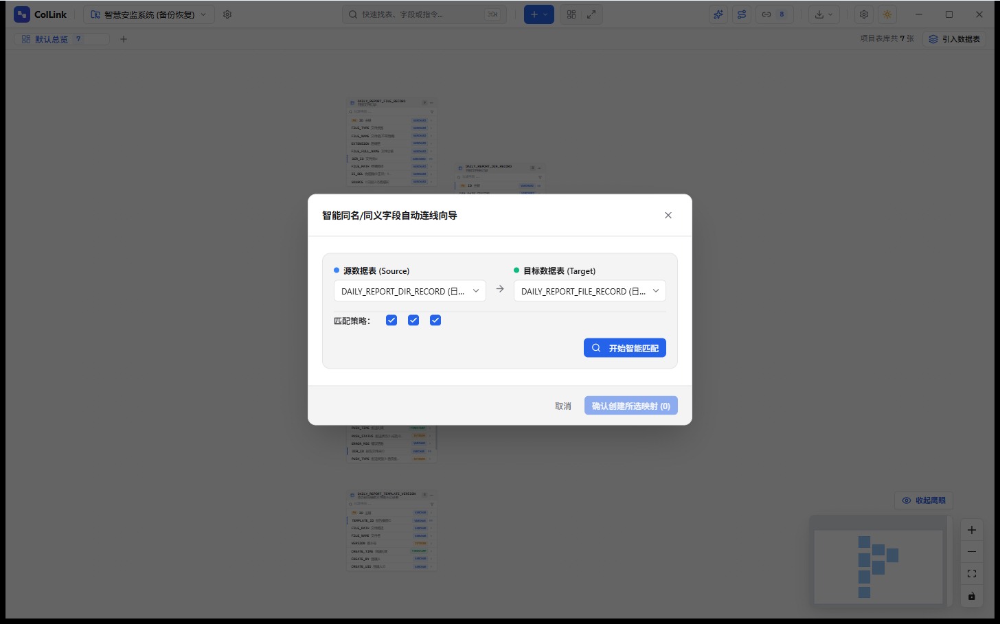
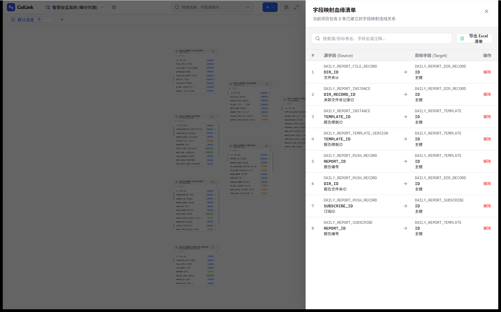
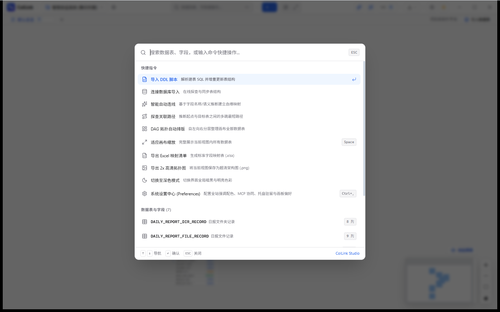
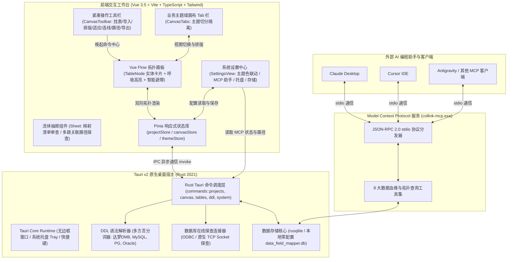

# ColLink (Column Linker)

<p align="center">
  
</p>

<p align="center">
  <strong>新一代轻量级、原生跨平台字段级数据血缘拓扑与映射设计平台</strong><br>
  <em>Next-Generation Visual Field-Level Lineage & Mapping Studio Powered by Tauri v2 + Rust</em>
</p>

<p align="center">
  
  
  
  
  
  
  
  
</p>

---

## 📖 项目背景与设计理念

在现代数据治理、数仓建模（ODS ➔ DWD ➔ DWS ➔ ADS）、数据指标中台建设及老旧系统重构割接过程中，数据研发工程师、数据架构师与 DBA 普遍面临以下痛点：
- **血缘关系口径割裂**：字段映射关系往往散落在海量复杂 SQL、ETL 脚本、存储过程或零散的手工 Excel 中，梳理耗时、人员交接成本极高；
- **大数据平台笨重臃肿**：开源或商业大数据元数据平台（如 DataHub、Apache Atlas）架构庞大，需依赖 Hadoop、Kafka、ElasticSearch，难以在本地快速轻量化启动；
- **通用绘图软件缺乏业务语义**：Visio、Draw.io、Figma 等工具无法感知数据表与字段结构，连线繁琐、卡片移动后走线缠绕凌乱，无法自动导出符合工程规范的数据字典。

**ColLink (Column Linker)** 专为解决上述痛点而打造：
- **零依赖单文件运行**：基于 **Tauri v2 + Rust** 构筑，内嵌原生 SQLite 引擎，体积仅约 20MB，不依赖 Python 或 Java 运行环境，开箱即用；
- **字段级拓扑与智能避障**：支持字段粒度精确连线，自适应几何最短路径计算与卡片避障折线算法，杜绝连线穿模与缠绕；
- **AI 助手深度协同**：内建独立的 **Model Context Protocol (MCP)** 服务，可无缝对接 Claude Desktop、Cursor、Antigravity 等前沿 AI 助手，以自然语言直接查询表结构、追溯上下游血缘与推理 JOIN 关联；
- **极致桌面级体验**：后台托盘驻留、深浅双模式随心切换、8 大主题强调色全链路联动、全局紧凑无折行标题栏与 GPU 加速流体抽屉动效。

---

## 🖼️ 系统界面预览 (UI Showcase)

### 1. 工作台主视图与 DAG 分层拓扑排版 (Workspace Overview)
> 现代化清爽画板，集成全局命令检索（`Ctrl+K`）、多业务主题域画布视图（Tabs）、DAG 有向分层拓扑智能排版、实时鹰眼导航与一键交付物导出体系。

<p align="center">
  
</p>

---

### 2. 字段级精准血缘连线与自适应避障 (Field Lineage & Smart Routing)
> 每个字段具备高亮交互锚点，支持字段名与注释模糊过滤；根据节点几何位置自适应选取最短路径左右锚点；单击激活字段双向呼吸发光，关联字段自动平滑滚入可视区域。

<p align="center">
  
</p>

---

### 3. 现代化系统设置中心与全站主题强调色联动 (Settings & Theme Engine)
> 遵循专业级设计规范的系统设置中心。支持浅色、深色及跟随系统显示模式；提供 8 种高饱和度品牌强调色，不仅控制按钮与高亮边框，更实时控制画布连线与流光光晕；支持点阵与方格底纹切换。

<p align="center">
  
</p>

---

### 4. Model Context Protocol (MCP) AI 助手协同接入 (MCP AI Integration)
> 专为 AI Native 时代打造。内建标准 JSON-RPC 2.0 stdio MCP 服务，一键复制 Claude Desktop、Cursor 或 Antigravity 接入配置，内置 8 项专业数据链路分析工具，让 AI 成为您的数据治理助手。

<p align="center">
  
</p>

---

### 5. 智能同名 / 同义字段自动连线向导 (Smart Auto-Mapping)
> 一键自动化建立跨表映射。支持同名字段忽略大小写与下划线精准对齐、中文业务注释同义词深度识别，支持冲突检测与已连线字段智能排除。

<p align="center">
  
</p>

---

### 6. 字段映射清单审查抽屉与流式交付物导出 (Mapping Drawer & Export)
> GPU 加速流体侧边抽屉，集中审查当前画布中全部字段级映射；支持秒级关键字过滤、快捷解除单条连线，以及一键流式导出专业美化双 Sheet Excel 报表与 2x 矢量拓扑长图。

<p align="center">
  
</p>

---

### 7. 全局命令中心与模糊检索 (Quick Command Palette)
> 键盘流重度用户的效率利器。按下 `Ctrl+K`（或 `⌘K`）瞬间唤出全局命令中心，支持在全项目中毫秒级模糊查找数据表、字段定义并一键聚焦跳转，支持快速触发拓扑自动排版、深浅模式切换与导出操作。

<p align="center">
  
</p>

---

## ✨ 核心特性矩阵

| 特性分类 | 功能亮点 | 技术实现与应用价值 |
| :--- | :--- | :--- |
| **画布拓扑** | **字段级精准连线** | 字段粒度双向交互锚点，光标悬停十字准星，拖拽瞬时拉出平滑映射连线 |
| | **智能避障折线算法** | 自动绕行中间数据表卡片，彻底根除线缆穿插与穿模 |
| | **最短路径几何就近** | 动态计算源/目标卡片相对方位，智能选取左右外侧就近锚点 |
| | **DAG 分层智能排版** | 基于 Sugiyama 算法的有向无环图自动分层布局，一键工整对齐拓扑流向 |
| **交互与视觉** | **全局紧凑纯图标栏** | 顶部标题栏纯图标化设计，外裹 Tooltip 提示，小窗口下彻底杜绝挤压换行 |
| | **全链路主题色联动** | 8 大强调色实时控制全站高亮、连线描边、悬停加粗、流光动效与端点箭头 |
| | **会话状态双层记忆** | 软件启动时自动恢复上次退出时的项目空间与激活画布视图，并自动居中聚焦 |
| | **流体硬件加速动效** | 抽屉与弹窗基于 `translate3d` 硬件加速及流体贝塞尔曲线，动效丝滑顺畅 |
| | **深浅双色与平滑波纹** | 浅色极简清爽、深色护眼通透，点击切换伴随全屏扩散水波纹过渡动画 |
| **AI 协同** | **MCP 协议原生服务** | 独立编译的 `collink-mcp.exe`，支持 JSON-RPC 2.0 stdio 本地双向通信 |
| | **8 大专业治理工具** | AI 助手可直接调用查表、查列、追溯血缘链路、路径探查与导出拓扑图谱 |
| | **一键生成客户端配置** | 设置页内置 Claude Desktop、Cursor 与 Antigravity 标准配置片段一键复制 |
| **采集与导出** | **多方言 DDL 智能解析** | 深度支持国产达梦 (DM8/DM7)、MySQL、PostgreSQL 及 Oracle 建表与注释语法 |
| | **在线数据库逆向探查** | 直连拉取达梦/MySQL/PG 数据字典，本地安全保存连接凭证，免重复输入 |
| | **双工作表 Excel 导出** | 自动生成 *Sheet1: 字段映射清单* 与 *Sheet2: 表结构字典* 规范化交付报表 |
| | **2x 高清矢量长图** | 动态注入当前主题色，一键导出 2x 超清 PNG 架构全景拓扑长图 |
| | **工程快照与跨机迁移** | 完整工程一键导出为 `.json` 结构快照，支持离线备份与多机无缝还原 |
| **桌面级内核** | **Tauri v2 + Rust 架构** | 内存占用低至约 50MB，启动瞬发，告别 Electron 与 Python 的庞大体积 |
| | **后台托盘静默驻留** | 支持关闭时最小化到系统托盘，后台持续就绪，双击托盘极速唤起 |
| | **防冲突撤销重做** | 严格区分画布操作历史与输入框原生打字焦点，支持 `Ctrl+Z` / `Ctrl+Y` |

---

## 🤖 Model Context Protocol (MCP) AI 助手接入指南

ColLink 独立编译了高性能的 `collink-mcp.exe`。接入后，您可以直接在 Claude Desktop、Cursor 或 Antigravity 中向 AI 提问：

> *“帮我查一下当前项目里有哪些关于订单的表？”*<br>
> *“从 `ods_orders.order_id` 出发，追溯它下游流向了哪些汇总字段？”*<br>
> *“帮我探查 `user_info` 表和 `pay_record` 表之间的关联路径并生成 SQL JOIN 语句。”*

### 1. 获取 MCP 二进制路径
在 ColLink 界面右上角点击 **「设置 (Ctrl+,)」➔「MCP 协同」**，即可查看已去除任何多余前缀的标准执行路径（例如：`C:\Users\...\ColLink-v1.0.0-Portable\collink-mcp.exe`）。

### 2. 客户端配置示例

#### Claude Desktop 配置 (`claude_desktop_config.json`)
```json
{
  "mcpServers": {
    "collink": {
      "command": "C:\\path\\to\\collink-mcp.exe",
      "args": []
    }
  }
}
```

#### Cursor IDE 配置 (`~/.cursor/mcp.json`)
```json
{
  "mcpServers": {
    "collink": {
      "command": "C:\\path\\to\\collink-mcp.exe",
      "args": [],
      "transport": "stdio"
    }
  }
}
```

#### Antigravity / 通用客户端配置
```json
{
  "name": "collink-mcp",
  "type": "stdio",
  "command": "C:\\path\\to\\collink-mcp.exe",
  "args": []
}
```

### 3. 内置 8 大 MCP 治理工具

| 工具标识 (Tool Name) | 分类 | 功能描述与输出契约 |
| :--- | :--- | :--- |
| `list_tables` | 元数据 | 获取当前项目中的全部表名、字段总数与业务中文注释 |
| `inspect_table` | 元数据 | 深入查询指定表的全部字段物理名、数据类型、主键标识与详细注释 |
| `get_lineage_path` | 血缘链路 | 全链路追溯指定字段的上游输入来源与下游输出归宿链路 |
| `search_mappings` | 血缘链路 | 按关键字模糊检索画板中已建立的字段级映射关系 |
| `discover_relation_path` | 智能推理 | 基于外键与字段同义词关系，智能推导两张表间的最优多跳 JOIN 路径 |
| `export_lineage_graph` | 拓扑导出 | 以标准 JSON 拓扑格式导出当前画板全量节点与连线数据 |
| `list_projects` | 工程空间 | 列出本地 SQLite 数据库中已创建的所有项目工作空间 |
| `get_project_detail` | 工程空间 | 获取指定项目详情及其包含的所有业务主题域画布列表 |

---

## ⌨️ 全局快捷键指南 (Shortcuts)

| 快捷键 | 作用域 | 功能描述 |
| :--- | :--- | :--- |
| **`Ctrl + K`** | 全局 | 唤起全局快速命令中心，支持模糊搜索表名、注释与字段名并推镜聚焦 |
| **`Ctrl + ,`** | 全局 | 极速打开 / 关闭系统设置中心（外观、MCP、常规、数据存储） |
| **`Esc`** | 全局 | 退出设置中心返回画板 / 关闭当前打开的抽屉或弹窗 / 取消字段聚焦 |
| **`Ctrl + Z`** | 画布 | 撤销上一步连线或卡片操作（输入框文字编辑时不拦截） |
| **`Ctrl + Y`** / **`Ctrl + Shift + Z`** | 画布 | 重做上一步撤销的操作 |
| **`Space` + 鼠标左键拖拽** | 画布 | 快速平移漫游画板视野 |
| **鼠标滚轮** | 画布 | 画布缩放（支持 0.1x ~ 2.0x 无级自适应缩放） |
| **鼠标单击字段** | 画布 | 激活字段血缘脉冲连线，目标远端对应字段自动滚动对齐进视野 |
| **点击画板空白处** | 画布 | 取消字段聚焦，恢复清爽默认状态 |

---

## 🏗️ 系统技术架构



---

## 📦 下载与安装指南

### 1. 绿色免安装便携版（推荐）
直接下载并解压发布包中的绿色便携文件夹：
- 存放位置：`release/ColLink-v1.0.0-Portable/`
- 主程序：直接双击 **`ColLink.exe`** 即可瞬间启动运行，所有数据保存在同级或本地 AppData 目录中，拔出 U 盘随身携带；
- MCP 配套组件：同级目录已自带 **`collink-mcp.exe`**，可直接复制路径至 AI 助手使用。

### 2. Windows 标准安装程序
- 安装包：`release/ColLink_Setup_v1.0.0.exe`
- 双击运行安装向导，支持自定义安装路径、创建桌面快捷方式与开始菜单目录，支持控制面板一键卸载。

---

## 💻 开发者编译与构建指南

如需对 ColLink 进行二次开发、扩展数据库方言或自定义图元节点：

### 环境前置要求
- **Node.js**：v18.0.0 或更高版本，推荐 LTS
- **Rust**：1.75.0 或更高版本（通过 `rustup default stable` 安装）
- **C++ 构建工具**：Visual Studio 2022 C++ 桌面开发套件（包含 MSVC 工具链）
- **NSIS**（可选，仅打包安装包需要）：Nullsoft Scriptable Install System 3.x

### 1. 克隆代码仓库
```powershell
git clone https://github.com/your-org/ColLink.git
cd ColLink
```

### 2. 前端依赖安装与启动
```powershell
cd frontend
npm install
npm run dev
```

### 3. Tauri 桌面开发热重载模式
在项目根目录下执行：
```powershell
npm run tauri -- dev
```
系统将启动 Vite 开发服务器并拉起 Tauri 桌面原生窗口，支持前端热更新与 Rust 代码断点调试。

### 4. 生产包全量编译与打包
```powershell
# 1. 编译前端与 Tauri Release 可执行程序
npm run tauri -- build

# 2. 单独编译独立 MCP 服务二进制程序
cargo build --manifest-path src-tauri/Cargo.toml --release --bin collink-mcp

# 3. 使用 NSIS 生成 Windows 安装程序 (可选)
& 'C:\Program Files (x86)\NSIS\makensis.exe' installer.nsi
```
编译产物将自动生成在 `src-tauri/target/release/` 及 `release/` 目录中。

---

## 📂 项目工程目录索引

```
ColLink/
├── frontend/                        # 前端交互工程 (Vue 3 + Vite + TypeScript)
│   ├── src/
│   │   ├── api/                     # 后端通信契约封装 (api.ts)
│   │   ├── assets/                  # 静态样式、字体与品牌资产
│   │   ├── components/
│   │   │   ├── canvas/              # 画布核心组件
│   │   │   │   ├── AutoMappingDialog.vue    # 智能同名/同义字段自动匹配向导
│   │   │   │   ├── CanvasTabs.vue           # 业务主题域画布视图 Tab 栏
│   │   │   │   ├── CanvasToolbar.vue        # 紧凑纯图标化操作工具栏 (含 Tooltip)
│   │   │   │   ├── MappingDrawer.vue        # 字段映射血缘清单审查抽屉
│   │   │   │   ├── RelationPathDrawer.vue   # 跨表关联路径探查与 SQL JOIN 推导抽屉
│   │   │   │   ├── SmartObstacleEdge.vue    # 智能避障折线与动态主题色连线
│   │   │   │   └── TableNode.vue            # 数据表实体卡片 (字段过滤/折叠/呼吸光)
│   │   │   ├── common/              # 公共组件 (CommandPalette 快速找表找列)
│   │   │   ├── dialogs/             # 核心业务向导弹窗
│   │   │   │   ├── BackupDialog.vue         # JSON 快照备份与跨机迁移弹窗
│   │   │   │   ├── DbConnectDialog.vue      # 数据库直连逆向探查向导
│   │   │   │   ├── DdlImportDialog.vue      # DDL 文本与脚本解析向导
│   │   │   │   └── ProjectDialog.vue        # 项目空间管理与新建弹窗
│   │   │   └── ui/                  # 基础原子 UI 库 (Button, Dialog, Sheet, Select 等)
│   │   ├── stores/                  # Pinia 状态管理 (projectStore, canvasStore, themeStore)
│   │   ├── utils/                   # 工具库 (exportImage, toast, cn)
│   │   └── views/
│   │       ├── WorkspaceView.vue    # 工作台主画板视图 (Vue Flow 容器)
│   │       └── SettingsView.vue     # 系统设置中心 (外观模式/强调色/MCP配置/数据)
│   ├── package.json
│   ├── tailwind.config.js           # Tailwind CSS 与 tailwindcss-animate 配置
│   └── vite.config.ts
├── src-tauri/                       # Rust 原生后端与桌面集成工程 (Tauri v2)
│   ├── src/
│   │   ├── commands/                # Tauri 暴露给前端的 IPC 命令集合
│   │   │   ├── canvas.rs            # 画布视图 CRUD 与表节点位置同步
│   │   │   ├── ddl.rs               # DDL 脚本多方言解析调度
│   │   │   ├── export.rs            # Excel 报表与 JSON 快照导出
│   │   │   ├── mapping.rs           # 字段映射关系持久化与自动匹配算法
│   │   │   ├── project.rs           # 项目空间管理
│   │   │   ├── system.rs            # 系统状态、物理路径格式化与文件夹唤起
│   │   │   └── table.rs             # 数据表与列元数据维护
│   │   ├── db/                      # 嵌入式 SQLite 驱动、连接池与数据表迁移
│   │   ├── ddl_parser/              # 达梦/MySQL/PG/Oracle 纯 Rust DDL 分词语法分析器
│   │   ├── models/                  # 数据实体定义与序列化契约
│   │   ├── lib.rs                   # Tauri 运行时配置、托盘菜单与窗口生命周期
│   │   ├── main.rs                  # ColLink 桌面主程序入口
│   │   └── mcp_main.rs              # 独立的 collink-mcp.exe 进程入口 (JSON-RPC)
│   ├── Cargo.toml                   # Rust 依赖清单
│   └── tauri.conf.json              # Tauri 窗口大小、托盘与打包配置
├── docs/
│   └── images/                      # 高清界面预览截图资源
├── release/                         # 打包发布制品目录
│   ├── ColLink-v1.0.0-Portable/     # 绿色免安装便携版 (ColLink.exe + collink-mcp.exe)
│   └── ColLink_Setup_v1.0.0.exe     # Windows 标准安装程序
├── installer.nsi                    # NSIS 现代化安装包构建脚本
└── README.md                        # 项目说明文档
```

---

## 💡 常见问题与排查指南 (FAQ)

### Q1: 软件退出后重新打开，项目和画布为什么能自动恢复？
> **A**: ColLink 内置了双层本地状态持久化机制。当您切换项目或在业务画布 Tab 间切换时，系统会自动记录当前激活的项目 ID 和画布 ID。再次启动时将优先恢复，并自动调用 `fitView` 居中展示最优拓扑视野；即使某画布被删除，也会优雅回退至首个默认视图。

### Q2: 为什么选择 Tauri v2 + Rust 而不是传统的 Electron 或 Python？
> **A**: 
> 1. **体积与内存**：ColLink 整体便携包仅约 20MB，空闲内存占用低至 50MB 左右，远低于 Electron（动辄 150MB+ 包体积与 300MB+ 内存占用）；
> 2. **零环境依赖**：完全告别 Python 虚拟环境配置、解释器路径依赖与 C 扩展编译问题；
> 3. **极速性能**：基于 Rust 编写的纯原生 DDL 解析器与 SQLite 引擎，解析上万行 SQL 脚本仅需数毫秒。

### Q3: 切换主题强调色后，为什么画板上的连线也会实时变色？
> **A**: ColLink 实现了端到端的设计 Token 联动体系。全站 8 种精选强调色不仅注入到 CSS 变量 `--cl-primary`，同时连线描边、悬停高亮、血缘脉冲光效、端点箭头 Marker 及 2x 架构图导出均统一动态读取该 Token，确保整套画板风格浑然一体。

### Q4: 如何在不同业务主题域之间组织表关系？
> **A**: 在顶部工具栏下方的「画布视图 Tab 栏」点击 `+` 即可创建独立的业务主题画布（如 `交易结算主题`、`用户画像域`、`数仓分层总览`）。点击右上角 **「引入数据表」** 即可从当前项目表库中挑选关联表加入该视图，各画布间节点位置排版互不干扰。

---

## 📄 开源许可证

本项目基于 [MIT License](LICENSE) 协议开源。欢迎广大数仓开发、数据治理工程师与架构师共同体验交流！
